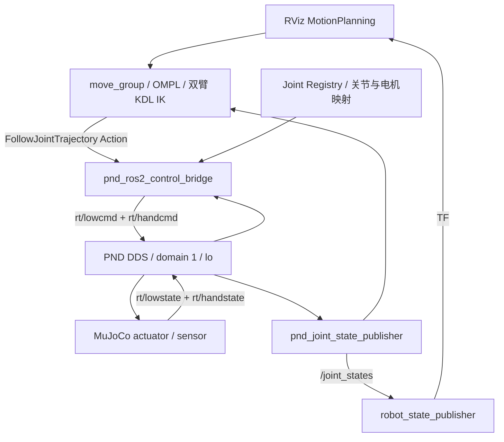

# 系统架构

[返回项目首页](README.md) · [运行命令](PROJECT_COMMANDS.md) · [项目状态](PROJECT_STATUS.md)

项目以 MuJoCo 为仿真端，通过 PND DDS 连接 Python ROS 控制层，再接入 MoveIt 2 和 RViz。`pnd_ros2_control` 是自定义的 ROS–DDS 桥，当前没有标准 `ros2_control` 的硬件插件与 `controller_manager`。

## 控制与反馈

控制桥将轨迹关节名映射到 SDK 顺序，再生成电机命令；仿真端执行命令并回传状态。状态节点独立生成 `/joint_states`，MoveIt 使用当前状态规划，`robot_state_publisher` 根据 URDF 计算 TF。

## 模块职责

| 模块 | 职责 | 入口 |
|---|---|---|
| MuJoCo | 场景加载、物理仿真、DDS 状态与控制 | [pnd_mujoco.py](pnd_mujoco/simulate_python/pnd_mujoco.py) |
| PND SDK | 消息定义、DDS 发布/订阅 | [pnd_sdk_python](pnd_sdk_python/) |
| 控制桥 | 轨迹 Action、命令映射、空闲保位、超时处理 | [pnd_ros2_control_bridge.py](src/pnd_ros2_control/pnd_ros2_control/pnd_ros2_control_bridge.py) |
| 状态节点 | 身体与手部状态转为 ROS JointState | [pnd_joint_state_publisher.py](src/pnd_ros2_control/pnd_ros2_control/pnd_joint_state_publisher.py) |
| 机器人描述 | URDF、mesh、碰撞几何、TF | [pnd_adam_description](src/pnd_adam_description/README.md) |
| 运动规划 | SRDF、IK、OMPL、控制器路由与 RViz | [pnd_adam_moveit_config](src/pnd_adam_moveit_config/README.md) |

## 接口约定

| 接口 | 消息 / 配置 | 用途 |
|---|---|---|
| `rt/lowcmd` / `rt/lowstate` | PND `LowCmd` / `LowState` | 31 个身体关节命令与状态 |
| `rt/handcmd` / `rt/handstate` | PND `HandCmd` / `HandState` | 12 个手部通道，沿用 SDK 原始位置值 |
| `/joint_states` | `sensor_msgs/msg/JointState` | 默认发布 43 个名称与状态 |
| `/tf`、`/tf_static` | TF | URDF 关节变换与静态基座关系 |
| `/body_controller/joint_trajectory` | `trajectory_msgs/msg/JointTrajectory` | 直接身体轨迹入口 |
| `/hand_controller/commands` | `std_msgs/msg/Float64MultiArray` | 按注册表顺序发送手部原始位置值 |

[MoveIt 控制器配置](src/pnd_adam_moveit_config/config/moveit_controllers.yaml)定义五个控制器：`body_controller`、`left_arm_controller`、`right_arm_controller`、`left_hand_controller`、`right_hand_controller`，分别对应 `/<控制器名>/follow_joint_trajectory`。桥还提供 `body_joint_trajectory_controller/follow_joint_trajectory` 兼容别名，共六个 Action 名称。

五个控制器共用桥中的轨迹状态；不要把多个 Action 名称理解为已经验证的独立并行执行能力。

## 默认参数

| 参数 | 默认值 | 配置位置 |
|---|---|---|
| 机器人 / 场景 | `adam_pro` / `adam_proximity_scene.xml` | [config.py](pnd_mujoco/simulate_python/config.py) |
| 仿真 DDS | domain `1`、网卡 `lo` | 同上 |
| 控制层 DDS | `domain_id:=1 interface:=lo` | [pnd_control.launch.py](src/pnd_ros2_control/launch/pnd_control.launch.py) |
| 控制定时器 / 状态发布 | `500 Hz` / `100 Hz` | 同上；是配置目标频率，非性能实测 |
| 空闲保位 | `idle_kp=5.0`、`idle_kd=1.0` | 同上 |
| 仿真步长 / Viewer 间隔 | `0.001 s` / `0.01 s` | `config.py` |
| 时间基准 | MoveIt `use_sim_time=false` | [moveit_bringup.launch.py](src/pnd_adam_moveit_config/launch/moveit_bringup.launch.py) |

PND 原始 DDS domain 与 ROS 的 `ROS_DOMAIN_ID` 是两层通信配置；修改其中一个不会自动修改另一个。当前默认链路未提供统一的 `/clock` 仿真时间方案。

## 模型与验证边界

- [关节注册表](src/pnd_ros2_control/config/pnd_joint_registry.yaml)连接 ROS 名称、SDK 索引、MuJoCo 控制索引与 PD 增益；腰部和手腕索引不能假定完全同序。
- 手部原始位置值尚未完整转换为 URDF 弧度。MuJoCo 手部有更细分的关节，不能将 43 个 ROS 状态通道直接当作模型全部物理自由度。
- `world → base_link` 使用静态 TF，未回读 MuJoCo 自由基座位姿；默认仿真开启弹性悬挂。
- Action 的成功主要依赖轨迹时间结束和 DDS 正常；最终位置误差、轨迹容差与并发执行仍需专项验证。
- MuJoCo 的旧 `ros2_adapter` 和 `legacy` 发布器不属于正式状态链路。具体限制见[项目状态](PROJECT_STATUS.md)，运行问题见[排查指南](docs/troubleshooting.md)。