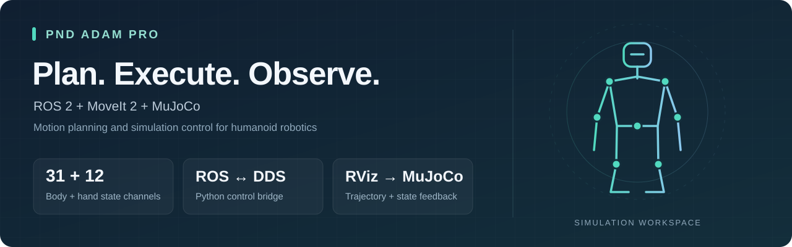
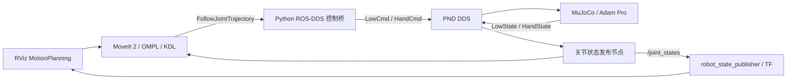

<div align="center">



# PND Adam Pro 仿真控制平台

**连接 MuJoCo 物理仿真与 MoveIt 2 运动规划，打通人形机器人的控制与状态反馈。**

    

[快速开始](#quick-start) · [系统架构](ARCHITECTURE.md) · [运行命令](PROJECT_COMMANDS.md) · [项目状态](PROJECT_STATUS.md) · [问题排查](docs/troubleshooting.md)

</div>

## 项目介绍

`pnd-adam-ros2-mujoco` 面向 **PND Adam Pro 人形机器人**，将 MuJoCo、PND Python DDS SDK、ROS 2 Humble、MoveIt 2 和 RViz 集成为一个仿真工作区。你可以在 RViz 中设置目标、规划双臂运动，将轨迹通过 ROS–DDS 控制桥发送到 MuJoCo，并从仿真回读关节状态与 TF。

项目适合学习人形机器人模型适配、MoveIt 配置、DDS 通信和仿真控制集成。机器人模型与底层 SDK 基于 PNDbotics 项目，当前仓库保存集成代码、配置、运行脚本和调试文档。原仓库名为 `0811`。

> **当前阶段：v0.1.0 冻结候选。** 原项目记录已验证左右臂和 body 的 Plan & Execute；本次整理核对代码、文档和脚本，没有重新运行 Ubuntu / ROS 仿真。默认使用弹性悬挂和固定基座 TF，后续计划包含手部轨迹、传感器扩展与 Sim2Real，详见[验证边界](PROJECT_STATUS.md)。

## 核心能力

| 模块 | 内容 | 代码与说明 |
|---|---|---|
| MuJoCo 仿真 | Adam Pro MJCF 模型、场景和 DDS 命令/状态接口 | [仿真入口](pnd_mujoco/simulate_python/pnd_mujoco.py) |
| ROS–DDS 控制桥 | 接收 `FollowJointTrajectory`，转换为 `LowCmd` / `HandCmd`；包含空闲低增益保位和 LowState 超时处理 | [控制桥](src/pnd_ros2_control/pnd_ros2_control/pnd_ros2_control_bridge.py) |
| 关节状态与 TF | 31 个身体关节 + 12 个手部通道，通过 `/joint_states` 和 `robot_state_publisher` 接入可视化 | [关节注册表](src/pnd_ros2_control/config/pnd_joint_registry.yaml) · [模型说明](src/pnd_adam_description/README.md) |
| MoveIt 2 规划 | 双臂 KDL IK、OMPL、碰撞模型与 RViz MotionPlanning | [MoveIt 配置](src/pnd_adam_moveit_config/README.md) |
| 启动与诊断 | 安装编译脚本、整栈启动、日志、关节限位审计 | [运行命令](PROJECT_COMMANDS.md) · [限位审计](JOINT_LIMIT_AUDIT.md) |

手部状态沿用 SDK 原始位置值，尚未完成与 URDF 弧度单位的一致性验证；表中“43”表示发布的状态通道数。控制桥是 Python Action/DDS 实现，当前没有标准 `ros2_control` 硬件插件或 `controller_manager`。

## 系统如何工作



默认仿真通信使用 **DDS domain 1 + `lo` 回环网卡**。正式 `/joint_states` 来自独立控制包；MuJoCo 旧 ROS 输出和 `legacy` 假状态发布器应保持关闭，避免状态冲突。完整接口与配置见[架构说明](ARCHITECTURE.md)。

<a id="quick-start"></a>

## 快速开始

### 1. 准备环境

| 项目 | 要求 |
|---|---|
| 操作系统 | Ubuntu 22.04 桌面环境 |
| ROS | 已安装 ROS 2 Humble，存在 `/opt/ros/humble/setup.bash` |
| Python | 系统 Python 3.10，能加载 ROS 的 `rclpy` |
| 图形环境 | 能运行 OpenGL、MuJoCo Viewer 和 RViz |
| 依赖版本 | MuJoCo `3.2.0`、CycloneDDS Python `0.10.2`，见 [requirements.txt](requirements.txt) |

以下命令在 Ubuntu 终端运行；仓库可放在任意目录。

### 2. 克隆、安装与编译

```bash
git clone https://github.com/hugh82617/pnd-adam-ros2-mujoco.git
cd pnd-adam-ros2-mujoco
bash scripts/setup_environment.sh
```

安装脚本会通过 `sudo apt-get` 安装构建与 ROS 依赖，再安装 Python 依赖和仓库内的 PND SDK，最后编译三个正式 ROS 包。脚本不会替你安装 ROS 2 Humble。已有环境可按[手动安装步骤](PROJECT_COMMANDS.md#manual-install)操作。

### 3. 启动仿真

```bash
bash start_pnd_adam.sh
```

脚本启动 **MuJoCo → ROS 控制层 → MoveIt 2 与 RViz**，并显示三份日志。按 `Ctrl+C` 停止整栈。自定义日志目录：

```bash
PND_LOG_DIR="$HOME/pnd_logs" bash start_pnd_adam.sh
```

### 4. 在 RViz 中规划与执行

1. 等待模型和当前关节状态加载完成。
2. 在 MotionPlanning 中选择 `right_arm` 或 `left_arm`。
3. 设置一个可达目标，点击 **Plan** 检查轨迹。
4. 点击 **Plan & Execute**，观察 MuJoCo 中的动作和 RViz 状态反馈。

在另一个终端加载环境后，可检查节点、Action 和关节状态：

```bash
source /opt/ros/humble/setup.bash
source install/setup.bash
ros2 node list
ros2 action list
ros2 topic echo /joint_states --once
```

若没有收到状态、RViz 缺少交互标记或出现关节限位警告，查看[问题排查](docs/troubleshooting.md)。

## 仓库结构

```text
.
├── src/
│   ├── pnd_adam_description/       # URDF / Xacro、mesh、TF 与模型生成工具
│   ├── pnd_adam_moveit_config/     # SRDF、IK、OMPL、控制器与 RViz 配置
│   └── pnd_ros2_control/           # Python ROS-DDS 控制桥、关节状态与测试
├── pnd_mujoco/                    # MuJoCo 仿真、Adam Pro 模型和场景
├── pnd_sdk_python/                # 仓库内的 PND Python DDS SDK
├── scripts/                       # 环境安装、关节限位审计
├── docs/                          # 排查指南、第三方来源、主页图示
├── legacy/                        # 历史示例，COLCON_IGNORE 隔离
├── start_pnd_adam.sh               # 整栈启动与停止
├── requirements.txt               # Python 依赖
└── README.md                      # 项目入口
```

正式工作区只构建 `src` 下的三个包。历史节点位于 `legacy/src`，不参与当前链路。

## 文档导航

| 想了解什么 | 从这里开始 |
|---|---|
| 能力、限制与后续路线 | [PROJECT_STATUS.md](PROJECT_STATUS.md) |
| 控制、反馈、规划与状态接口 | [ARCHITECTURE.md](ARCHITECTURE.md) |
| 手动安装、分终端启动、修改参数与检查 | [PROJECT_COMMANDS.md](PROJECT_COMMANDS.md) |
| 常见启动与规划问题 | [docs/troubleshooting.md](docs/troubleshooting.md) |
| 双膝初始姿态与限位冲突 | [JOINT_LIMIT_AUDIT.md](JOINT_LIMIT_AUDIT.md) |
| 机器人描述与 MoveIt 包 | [模型包](src/pnd_adam_description/README.md) · [规划包](src/pnd_adam_moveit_config/README.md) |
| 提交改进与复现信息 | [CONTRIBUTING.md](CONTRIBUTING.md) |
| 上游来源与许可说明 | [docs/third-party-notices.md](docs/third-party-notices.md) |

## 已知边界与后续计划

- 默认弹性悬挂用于仿真调试，基座 TF 为静态变换；当前未提供自主平衡或行走验证。
- 双膝初始 `q=0` 低于限位下界 `0.052 rad`；头部与手部未配置 IK。
- Action 成功依据主要为轨迹时间结束及 DDS 状态，尚未按最终关节误差严格判断到位。
- 手部单位对齐与轨迹、正式 ROS 传感器输出、Isaac Sim 和 Sim2Real 均为后续工作。

路线和验证范围见[项目状态](PROJECT_STATUS.md)。遇到问题可[提交 Issue](https://github.com/hugh82617/pnd-adam-ros2-mujoco/issues/new/choose)，请附系统版本、启动命令和相关日志。

## 来源与许可

感谢 [PNDbotics MuJoCo](https://github.com/pndbotics/pnd_mujoco)、[PND Python SDK](https://github.com/pndbotics/pnd_sdk_python) 及 ROS 2、MoveIt、MuJoCo 社区。仓库保留已有第三方版权与许可声明；各模块的许可情况见[第三方来源说明](docs/third-party-notices.md)。
